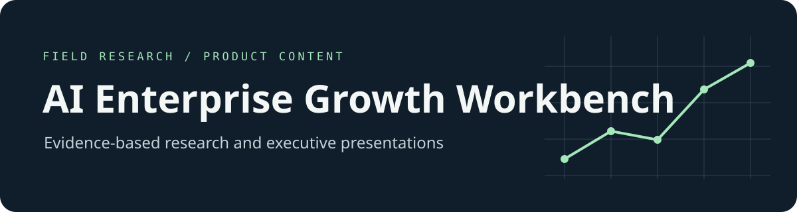

  

# AI 企业增长工作台

企业增长陪跑团队将增长诊断、竞品研究和产品表达中的工作方法，沉淀为两套面向硬件企业的 Codex Skills。从市场证据、客户反馈到产品规格和应用场景，每项交付都能回到可核查的资料。

[选择 Skill](#选择-skill) · [快速开始](#快速开始) · [团队与方法](docs/growth-practice.md)

## 选择 Skill

| Skill | 适合什么时候用 | 能交付什么 |
| --- | --- | --- |
| [企业增长情报](skills/hardware-market-radar/SKILL.md) | 做竞品调研、跟踪行业动态、复核价格快照或整理客户评价 | 有证据索引的调研报告、复查底表、口碑词云、可编辑汇报 PPT |
| [硬件产品展示页](skills/hardware-product-showcase/SKILL.md) | 已有产品资料，需要做官网产品页、目录页或展会落地页 | 可本地打开的 HTML，附工业机器人页面模板 |

市场雷达可单独完成调研。需要制作展示页时，可以把调研中发现的选型维度和客户关注点交给展示页 Skill，再用自家确认的产品资料填充规格和方案。

## 快速开始

把所需 Skill 的完整目录加入 Codex 的个人 Skills 目录，保留其中的 `SKILL.md`、引用资料和资源文件。词云和快照合并脚本需要 Python 3。联网调研和 PPTX 生成依赖运行环境中的相应工具。

**调研后做决策汇报**

> 用 `$hardware-market-radar` 调研中国大陆协作机器人市场，整理最近 30 天的行业动态、竞品公开营销动作和客户关注点，交付有直达证据链接的报告和管理层汇报。

**用已确认资料制作产品页**

> 用 `$hardware-product-showcase` 把我提供的型号、负载、臂展和三个应用场景整理成一页展会产品页，交付可本地打开的 HTML。

## 来自企业增长陪跑实践

年度方案把增长工作串在战略校准、品牌内容、获客、成交、组织和月度复盘六个环节里。本仓库优先沉淀两项可复用的工作。调研支持诊断和定位，产品页把卖点、规格和工况变成可检查的内容资产。

团队从组织与营销、战略与资本、项目与经营质量三个角度展开工作。[查看团队分工、案例与年度节奏](docs/growth-practice.md)。
